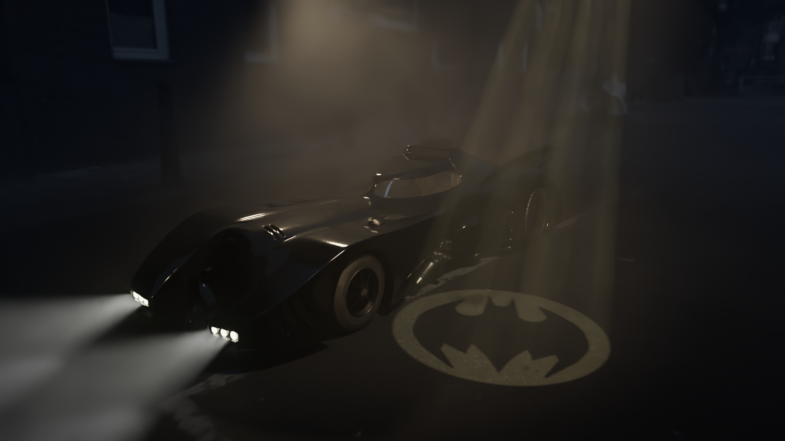
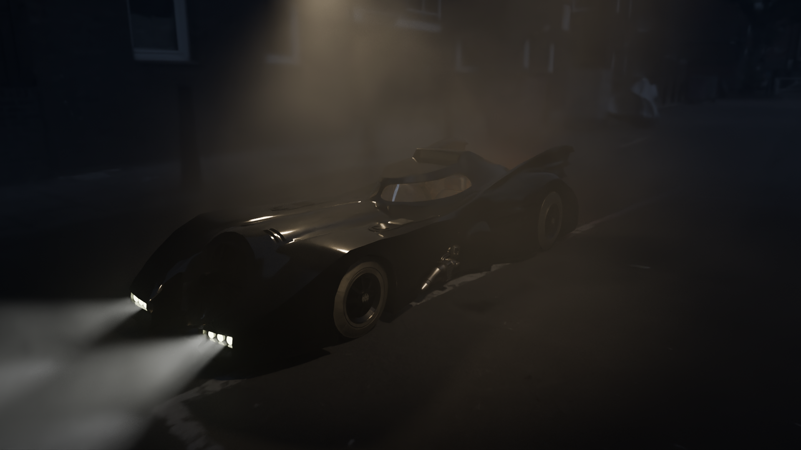
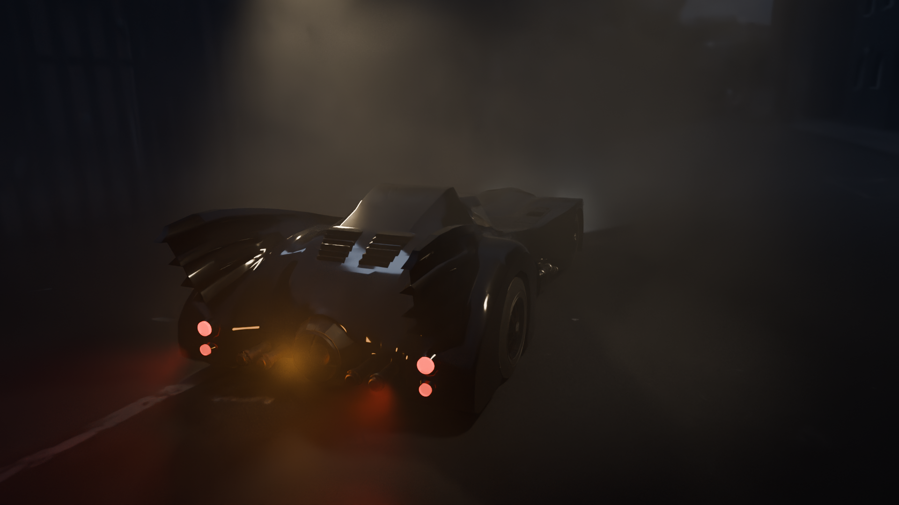
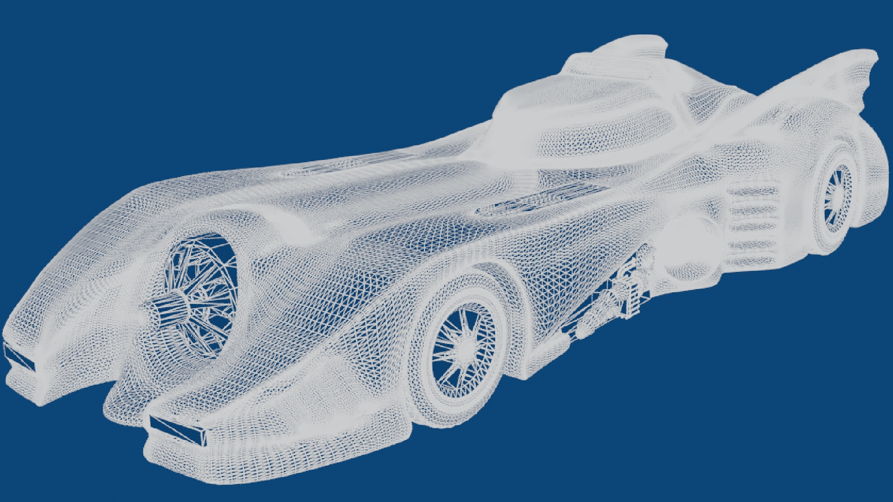

  

# 3D Content Creation — 1989 Batmobile

![LIT](https://img.shields.io/badge/Limerick%20Institute%20of%20Technology-2016-red?style=flat-square&logo=)

## 1989 Batmobile

3D model of the **1989 Batmobile** (Anton Furst / Tim Burton design), originally modelled in **Autodesk Maya** (`130` individual mesh components) and PBR-textured in **Adobe Substance Painter** for the *3D Content Creation* module at LIT, then migrated into **Blender 5.3** for film-accurate `6.63 m` scaling, Cycles OptiX volumetric night lighting, a physical 3D Bat-Signal gobo projection, an animated sliding cockpit canopy (`Canopy_Slide_Rig`), and Web AR (`1989_Batmobile.glb`).

> [!NOTE]  
> Open the [Live Showcase Hub](https://joeaoregan.github.io/LIT-VFX-3D-Content-Creation/) ([`index.html`](index.html)) to explore the Web AR app, Three.js HDRI viewer, YouTube turntable renders, Sketchfab 3D viewer, and all interactive parallax scroll pages.

> [!TIP]  
> **Try it in AR on your phone:** Open the [1989 Batmobile Web AR App](https://joeaoregan.github.io/LIT-VFX-3D-Content-Creation/ar/) in Chrome on Android (Google Pixel / WebXR) or Safari on iOS (Quick Look) and tap **View in Your Space (AR)** to place the `1.86 MB` Draco-compressed GLB directly in your environment.

---

## Final Renders

### Gotham Night Volumetrics & Bat-Signal (`v0024`)

| 6 Recessed Headlight Beams | Rear Tail Lights & Turbine Exhaust |
| :---: | :---: |
|  |  |

### Blueprint Wireframe (`batmobile_blueprint_0001`)

---

## Showcase Links

* **Web AR App (Google Pixel / iOS)**: [Launch 1989 Batmobile Web AR](https://joeaoregan.github.io/LIT-VFX-3D-Content-Creation/ar/) ([`ar/index.html`](ar/index.html)) — Real-world `6.63 m` placement via `<model-viewer>` (`WebXR · Scene Viewer · Quick Look`) using [`1989_Batmobile.glb`](1989_Batmobile.glb)
* **Interactive 3D Viewers**:
  * **Three.js + Street HDRI**: [Open Real-Time WebGL Viewer](https://joeaoregan.github.io/LIT-VFX-3D-Content-Creation/threejs/) ([`threejs/index.html`](threejs/index.html))
  * **Click & Drag 360° Viewer (`v0024`)**: [Open Interactive Drag-to-Spin](https://joeaoregan.github.io/LIT-VFX-3D-Content-Creation/0024/drag360/) ([`0024/drag360/index.html`](0024/drag360/index.html))
  * **Sketchfab 3D Model**: [View 1989 Batmobile on Sketchfab](https://sketchfab.com/3d-models/1989-batmobile-e9234d292c5646eaa4c3068769edb40a) (`1989_Batmobile.fbx`)
* **YouTube Turntable & Top-Down Renders**:
  * [v0014 — Gotham Night Volumetrics](https://youtu.be/OVfGsIVgiR0)
  * [v0024 — Bat-Signal, 6 Recessed Beams & Smoothed Wheel Arches](https://youtu.be/h6Unr17XtrM)
  * [Blueprint — 3D Wireframe Turntable](https://youtu.be/MJmXyEqHYuQ)
  * [Top-Down Gotham Night & Sliding Canopy (Blender Cycles)](https://youtu.be/XgKmxd9SUYU)
  * [Top-Down Studio Playblast & Sliding Canopy (Blender 5.3)](https://youtu.be/_-2cVurDbHU)
  * [Top-Down Blueprint Wireframe & Sliding Canopy (Blender Cycles)](https://youtu.be/kJgXyCPuVtI)
* **Original LIT Maya / Substance Videos**:
  * [Joe O'Regan — 3D Model — 1989 Batmobile](https://youtu.be/sfj_AB1JosA)
  * [VFX Complex Model Playblast — Wireframe on Shaded & Unsmoothed](https://youtu.be/r7bBhWpIdPg)
  * [VFX Complex Model Playblast — Smoothed](https://youtu.be/vhfQ9UmzQXQ)
  * [VFX Complex Model Render](https://youtu.be/vbbqeF0mDLI)
  * [1989 Batmobile Model](https://youtu.be/nH9MvN5YS1Y)
* **Interactive 360° Parallax Scroll Pages**:
  * **v0014**: [8 FPS](0014/8fps/index.html) · [10 FPS](0014/10fps/index.html) · [24 FPS](0014/full_240fps24/index.html)
  * **v0024**: [8 FPS](0024/8fps/index.html) · [10 FPS](0024/10fps/index.html) · [24 FPS](0024/full_240fps24/index.html) · [HDRI Top-Down Cockpit (`v0027`)](hdri-topdown/index.html) ([Live](https://joeaoregan.github.io/LIT-VFX-3D-Content-Creation/hdri-topdown/))
  * **Blueprint Wireframe**: [360° Turntable + Comic Trivia](blueprint/index.html) · [Top-Down Canopy Open/Close Parallax](blueprint-topdown/index.html) ([Live](https://joeaoregan.github.io/LIT-VFX-3D-Content-Creation/blueprint-topdown/))